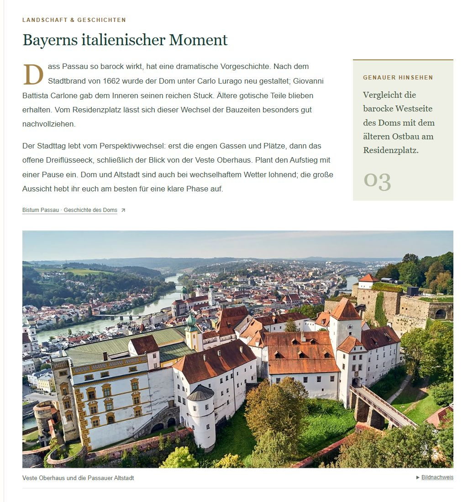
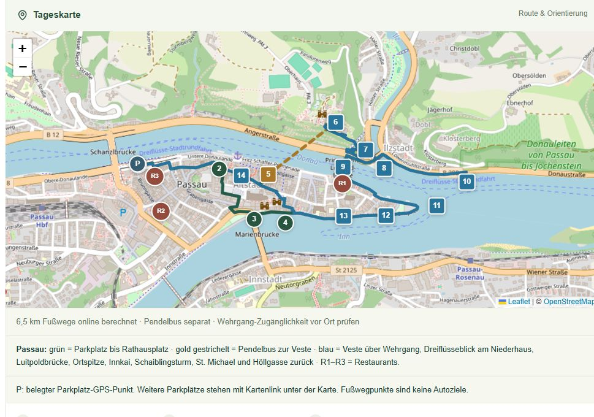
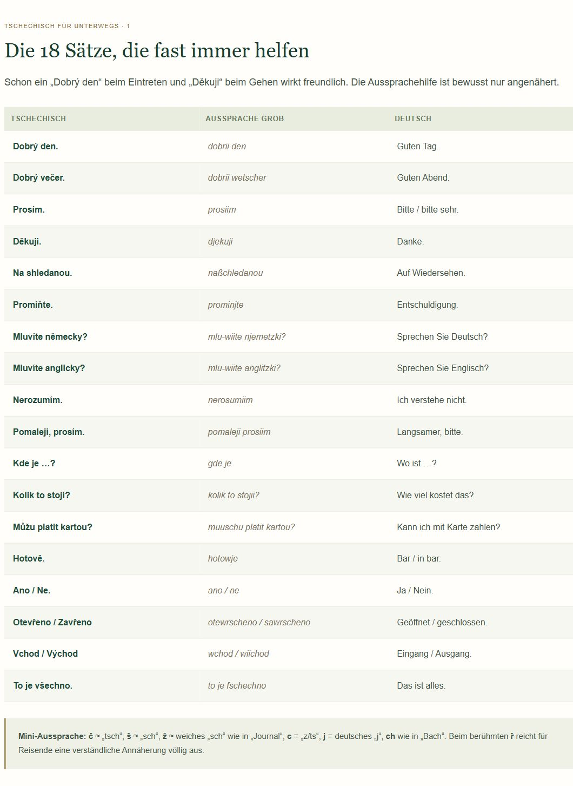

# 🧭 Reisefolio

> **Dein individueller digitaler Reiseführer**  
> Von der Planung bis zum Reisetagebuch.

[📄 Deutscher Masterprompt](prompts/reisefolio.de.txt) · [📄 English prompt](prompts/reisefolio.en.txt) · [Read in English ↓](#english)

---

**DEUTSCH**

Reisefolio ist ein Masterprompt für ChatGPT. Ein geführter Wizard erfasst Reiseziel, Zeitraum, Reisende, Verkehrsmittel, Unterkünfte, Interessen, Rahmenbedingungen und Sprachen. Darauf aufbauend beauftragt der Prompt eine persönliche Reisewebseite mit Planung, Reisewissen und Tagebuch.

Eine frühere Webseite oder ein bestimmter Reiseführer wird nicht benötigt. Gestaltung und Inhalte werden an die jeweilige Reise angepasst.

**📷 Beispiele aus einer bestehenden Reisewebseite**

| Reiseführer & Ortsinformationen | Tageskarte & Route | Reisewissen & Sprachhilfe |
|:---:|:---:|:---:|
|  |  |  |

**🔑 Voraussetzungen**

- **ChatGPT mit mindestens einem Plus-Abo** ist die Voraussetzung für den unterstützten Einsatz dieses Projekts.
- Die verwendete ChatGPT-Umgebung muss die benötigten Funktionen bereitstellen: Webrecherche, Erstellung und Veröffentlichung einer Webseite mit dauerhafter Datenhaltung sowie Zeitplanung für Hintergrundaufgaben. Für den hier vorgesehenen gehosteten Einsatz wird ChatGPT Sites benötigt.
- Der Prompt ist zunächst ausschließlich für ChatGPT vorgesehen. Andere KI-Dienste werden derzeit nicht unterstützt.
- Funktionsverfügbarkeit und Nutzungslimits hängen vom Konto und der Umgebung ab. Ein Prompt allein richtet keine fehlenden Dienste ein.

Aktuelle Produktinformationen: [ChatGPT Sites](https://learn.chatgpt.com/docs/sites) und [ChatGPT Work](https://learn.chatgpt.com/docs/get-started-with-work).

---

**🚀 So benutzt Du den Prompt**

> **In fünf Schritten zur eigenen Reisewebseite**  
> Starten · Wizard beantworten · Im Dialog ausarbeiten · Prüfen und veröffentlichen · Weiter pflegen

Du beschreibst Deine Wünsche in normaler Sprache; Programmierkenntnisse werden für diesen Ablauf nicht vorausgesetzt.

**1. Masterprompt starten**

Öffne [den deutschen Masterprompt](prompts/reisefolio.de.txt), zeige über **Raw** den reinen Text an und kopiere ihn vollständig in einen neuen Chat in der unter „Voraussetzungen“ beschriebenen ChatGPT-Umgebung. Sende den Text ab – eine zusätzliche Startanweisung ist nicht erforderlich. Unbekannte Platzhalter dürfen offen bleiben.

Alternativ steht [eine vollständige englische Übersetzung](prompts/reisefolio.en.txt) zur Verfügung. Beide Fassungen beauftragen dieselben Funktionen. Die Sprache der späteren Webseite wählst Du im Wizard.

**2. Den Wizard beantworten**

ChatGPT fragt Schritt für Schritt nach Reiseziel, Zeitraum, Reisenden und weiteren Rahmenbedingungen, mit höchstens drei Fragen je Nachricht. Beantworte die Fragen, ergänze vorhandene Buchungen oder Wunschziele und korrigiere Angaben bei Bedarf. Sobald die entscheidenden Informationen vorliegen, soll ChatGPT die erste Webseite erstellen.

**3. Die Webseite im Dialog ausarbeiten**

Öffne die erste Fassung und prüfe Planung, Gestaltung und Bedienung. **Arbeite anschließend mit weiteren Nachrichten im selben Chat weiter:** Lass fehlende Inhalte ergänzen, einzelne Tage überarbeiten, das Design anpassen und Funktionen verbessern, bis die Webseite zu Deiner Reise passt. Je nach Umfang sind dafür mehrere Abstimmungen nötig.

Formuliere konkrete Änderungsaufträge und nenne den betroffenen Tag oder Bereich. Beschreibe bei Fehlern, was Du getan hast, was passiert ist und welches Ergebnis Du erwartest; ein Screenshot kann helfen. Prüfe das Ergebnis nach jeder Änderung.

<strong>💬 Fünf Beispielprompts zum Ausprobieren</strong>

Ersetze die Platzhalter vor dem Verwenden.

**Tagesplanung verfeinern**

> „Plane den [DATUM] mit höchstens [X] km Fußweg neu. Passe danach auch Texte, Karten, Parkplätze und Restaurants dieses Tages an. Bewahre meine Tagebucheinträge und eigenen Hero-Bilder.“

**Inhalte ergänzen**

> „Ergänze zu den Aktivitäten am [DATUM] die Öffnungszeiten, Eintrittspreise und offiziellen Buchungslinks mit Quelle und Prüfdatum.“

**Bedienung verbessern**

> „Die Tageskarten sind auf meinem Smartphone zu lang. Kürze die Vorschautexte und halte die Buttons zum Öffnen und Bearbeiten gut erreichbar.“

**Tatsächliche Erlebnisse eintragen**

> „Am [DATUM] haben wir [ORT] besucht und [AKTIVITÄT] ausgelassen. Aktualisiere den Besuchsstatus und übernimm diesen Text als Tagesnotiz: [TEXT].“

**Nachträglich umplanen**

> „Wir reisen schon am [DATUM] zurück. Passe die restliche Planung und die Rückreiseroute an. Erhalte alle vorhandenen Tagebucheinträge und Fotos.“

**4. Prüfen und veröffentlichen**

Lass ChatGPT die vereinbarten Funktionen tatsächlich prüfen, insbesondere PIN-Schutz, Speichern, Fotos, Sprachversionen, Smartphone-Bedienung und eingerichtete Hintergrundaufgaben. Teste selbst die für Dich wichtigen Abläufe. Richte die PIN geschützt ein und lege fest, wer die Webseite sehen darf. Beauftrage die Veröffentlichung des geprüften Stands ausdrücklich und kontrolliere danach den veröffentlichten Link.

**5. Während und nach der Reise weiterarbeiten**

Nutze den bisherigen Chat oder öffne die bestehende Webseite wieder in ChatGPT Sites und beschreibe die gewünschten Änderungen. Bei einem neuen Chat gib den Link an und sage ausdrücklich, dass diese bestehende Webseite bearbeitet werden soll. Für spätere Anpassungen musst Du den gesamten Masterprompt nicht erneut einfügen. Für eine neue Reise startest Du dagegen einen neuen Durchlauf.

So kannst Du später Ziele austauschen, den Reisezeitraum ändern, Funktionen ergänzen oder die Gestaltung weiterentwickeln. Notizen, Fotos und Besuchsstatus kannst Du nach ihrer Umsetzung auch direkt im PIN-geschützten internen Bereich pflegen.

Weitere Hinweise zum Erstellen und schrittweisen Überarbeiten bietet die [offizielle ChatGPT-Anleitung zu Sites](https://learn.chatgpt.com/docs/sites/creating-a-site).

<strong>🗺️ Funktionsübersicht</strong>

| Bereich | Funktionen |
|---|---|
| Reiseplanung | Etappen, Tagesprogramme, Ruhetage, Alternativen, Restaurants, Unterkünfte und eigene Ziele |
| Orientierung | Tageskarten, Routen, Parkplätze, Haltestellen und geprüfte Navigationslinks |
| Reisewissen | Zur Region und Reiseart passende Hintergrundinformationen und praktische Hinweise |
| Tagebuch | Tages- und Aktivitätsnotizen, Besuchsstatus, mehrere Fotos, Untertitel, Lightbox und eigene Hero-Bilder |
| Interner Bereich | Serverseitiger PIN-Schutz, Bearbeitung, Einstellungen und Freigabe von Neuplanungen |
| Wetter | Tatsächliche Datenabrufe mit Quelle, Zeitstempel, Gültigkeit und Fehleranzeige |
| Automatismen | Wetter, Prüfung geänderter Reiseinformationen, Sicherungen und Übersetzungsabgleich |
| Smartphone/PWA | Responsive Darstellung, installierbare PWA und gekennzeichnete Offline-Inhalte, soweit umsetzbar |

<strong>🌐 Mehrsprachigkeit</strong>

**Standard:** Alle angegebenen Sprachen sind vollständig bedienbar, einschließlich PIN-Zugang, internem Bereich und Bearbeitung. Sie nutzen gemeinsame Reisedaten.

**Optional:** Zusätzliche Sprachen werden als statische Informationsseiten ohne internen Bereich veröffentlicht. Der Wizard fragt freigegebene Inhalte, Intervall, Uhrzeit, Zeitzone und Laufzeit ab. Auch unterschiedliche Modi je Sprache sind möglich.

<strong>📌 Verbindliche Grundregeln</strong>

- Hero-Bilder zeigen echte Fotografien der konkreten Orte. Keine generierten Ersatzbilder; eigene Bilder haben Vorrang.
- Wetter und Reiseinformationen dürfen automatisch aktualisiert werden. Änderungen am Tagesplan brauchen standardmäßig Deine Freigabe.
- Nach einer freigegebenen Neuplanung werden alle betroffenen Tagesinhalte angepasst, einschließlich Karten, Parkplätzen, Texten und Bildern.
- Eigene Texte, Bilder und tatsächliche Besuche bleiben erhalten. Erlebnisse werden nicht erfunden.
- Private Daten und Schreibzugriffe werden auf dem Server geschützt. Ein ausgeblendetes Menü genügt nicht.
- Hintergrundaufgaben müssen auch bei geschlossener Webseite laufen. Nicht eingerichtete Funktionen dürfen nicht als aktiv dargestellt werden.

<strong>ℹ️ Projektstand und Grenzen</strong>

Das Repository enthält den Prompt und seine Dokumentation, keine bereits installierte Reiseanwendung. Die englische Fassung ist eine Übersetzung des deutschen Originals; ein eigener vollständiger Umsetzungslauf mit dieser Fassung wurde noch nicht durchgeführt. Die deutsche Fassung geht auf die bisherige Reisewebseite zurück, ist aber kein Nachweis, dass jede hier beschriebene Funktion in jeder Umgebung verfügbar ist.

<strong>🤝 Mitmachen</strong>

Fehlerberichte, verständlichere Formulierungen, Übersetzungsverbesserungen und dokumentierte Praxiserfahrungen sind willkommen. Bitte beachte [CONTRIBUTING.md](CONTRIBUTING.md). Verwende Issues für Fehler und Ideen und Pull Requests für konkrete Änderungen. Veröffentliche dabei keine PINs, Buchungsnummern oder privaten Reisedaten.

<strong>⚖️ Urhebernennung und Lizenz</strong>

Projektinitiator: **Michael ([brun-soft](https://github.com/brun-soft))**. Der Masterprompt wurde gemeinsam mit ChatGPT entwickelt; die englische Übersetzung wurde mit ChatGPT erstellt.

Die Promptfassungen und die eigene Dokumentation dieses Projekts stehen unter **[CC BY-NC-SA 4.0](https://creativecommons.org/licenses/by-nc-sa/4.0/deed.de)**. Du darfst sie für nichtkommerzielle Zwecke verwenden, verändern und weitergeben. Bei Weitergabe sind angemessene Namensnennung, Lizenzverweis und Änderungshinweis erforderlich; veröffentlichte Bearbeitungen müssen die ShareAlike-Bedingungen erfüllen. Der vollständige Lizenztext steht in [LICENSE](LICENSE).

Beispiel für einen Quellenhinweis:

> Reisefolio-Prompt von Michael (brun-soft), https://github.com/brun-soft/reisefolio-prompt, lizenziert unter CC BY-NC-SA 4.0 (https://creativecommons.org/licenses/by-nc-sa/4.0/). Änderungen: [kurze Beschreibung oder „keine“]. Ohne Gewähr; siehe Lizenztext.

Die Lizenz des Prompts verlangt nicht automatisch eine Namensnennung auf jeder damit erzeugten Webseite. Soweit lizenzierte Inhalte übernommen werden, gelten deren Bedingungen auch dort. Fremde Fotos, Karten und andere eingebundene Inhalte behalten ihre jeweiligen Nutzungsbedingungen. Das kostenpflichtige ChatGPT-Abo ist eine technische Nutzungsvoraussetzung, keine Lizenzgebühr für Reisefolio.

---

## English

> **Your personal digital travel guide**  
> From planning to a travel diary.

Reisefolio is a master prompt for ChatGPT. A conversational wizard collects your destination, dates, travellers, transport, accommodation, interests, constraints and languages. The prompt then commissions a personal travel website with itineraries, practical travel information and a diary.

No previous website or specific guidebook is required. Design and content are tailored to the trip.

**📷 Examples from an existing travel website**

| Travel guide & place information | Daily map & route | Travel information & language help |
|:---:|:---:|:---:|
|  |  |  |

**🔑 Requirements**

- **ChatGPT with at least a Plus subscription** is required for this project's supported use.
- Your ChatGPT environment must provide the necessary capabilities: web research, website creation and publication with persistent storage, and scheduled background tasks. The intended hosted workflow requires ChatGPT Sites.
- The prompt currently targets ChatGPT only. Other AI services are not supported at this stage.
- Capabilities and usage limits depend on your account and environment. A prompt alone cannot provision unavailable services.

Current product information: [ChatGPT Sites](https://learn.chatgpt.com/docs/sites) and [ChatGPT Work](https://learn.chatgpt.com/docs/get-started-with-work).

---

**🚀 How to use the prompt**

> **Five steps to your own travel website**  
> Start · Answer the wizard · Refine through chat · Check and publish · Keep updating

Describe what you want in everyday language; this workflow does not assume programming knowledge.

**The original master prompt is written in German. A complete English translation is also included.** The English version has not yet undergone a separate full website implementation run.

**1. Start the master prompt**

Open the [English prompt](prompts/reisefolio.en.txt), or choose the [German original](prompts/reisefolio.de.txt). Use **Raw** to view the plain text and copy it in full into a new chat in the ChatGPT environment described under “Requirements”. Send the text – no extra start instruction is needed. You may leave unknown placeholders empty.

Both versions commission the same capabilities. Choose the website's languages in the wizard.

**2. Answer the wizard**

ChatGPT asks about your destination, dates, travellers and other requirements step by step, with no more than three questions per message. Answer the questions, add existing bookings or places you want to visit, and correct details where needed. Once the essential information is available, ChatGPT should build the first website.

**3. Develop the website through conversation**

Open the first version and review the itinerary, design and usability. **Continue with follow-up messages in the same chat:** ask for missing content, revised daily plans, design changes and improved functionality until the website fits your trip. Depending on its scope, this may take several rounds.

Give specific change requests and identify the affected day or section. For bugs, explain what you did, what happened and what you expected; a screenshot may help. Check the result after each change.

<strong>💬 Five example prompts to try</strong>

Replace the placeholders before use.

**Refine a daily plan**

> “Replan [DATE] with no more than [X] km of walking. Update that day's text, maps, parking and restaurants as well. Preserve my diary entries and personal hero images.”

**Add information**

> “Add opening hours, admission prices and official booking links for the activities on [DATE], including sources and check dates.”

**Improve usability**

> “The day cards are too long on my smartphone. Shorten the preview text and keep the open and edit buttons easy to reach.”

**Record actual experiences**

> “On [DATE] we visited [PLACE] and skipped [ACTIVITY]. Update the visit status and save this as the daily note: [TEXT].”

**Adjust the trip later**

> “We are returning home on [DATE] instead. Update the remaining itinerary and return route. Preserve all existing diary entries and photos.”

**4. Check and publish**

Have ChatGPT actually verify the agreed features, particularly PIN protection, saving, photos, language versions, mobile usability and configured background jobs. Try the workflows that matter most to you. Set the PIN through a protected setup and choose who may see the website. Explicitly request publication of the reviewed version, then check the published link.

**5. Continue during and after the trip**

Use the existing chat, or reopen the existing website in ChatGPT Sites and describe the changes you want. In a new chat, provide the link and explicitly ask to edit that existing website. You do not need to paste the entire master prompt again for later changes. For a new trip, start a fresh run.

You can later replace destinations, change travel dates, add features or refine the design. Once implemented, notes, photos and visit status can also be managed directly in the PIN-protected internal area.

See the [official ChatGPT Sites guide](https://learn.chatgpt.com/docs/sites/creating-a-site) for more on creating and refining a website step by step.

<strong>🗺️ Feature overview</strong>

| Area | Capabilities |
|---|---|
| Planning | Trip stages, daily itineraries, rest days, alternatives, restaurants, accommodation and custom destinations |
| Navigation | Daily maps, routes, parking, public transport stops and verified navigation links |
| Travel information | Background and practical guidance tailored to the destination and type of trip |
| Diary | Daily and activity notes, visit status, multiple photos, captions, a lightbox and personal hero images |
| Internal area | Server-side PIN protection, editing, settings and approval of itinerary changes |
| Weather | Actual data retrieval with source, timestamps, validity and error states |
| Automations | Weather updates, checks for changed travel information, backups and translation synchronisation |
| Mobile/PWA | Responsive layouts, an installable PWA and clearly labelled offline content where supported |

<strong>🌐 Multilingual websites</strong>

**Default:** All selected languages support the full application, including PIN access, the internal area and editing. They share the same trip data.

**Optional:** Additional languages are published as static information pages without an internal area. The wizard asks for approved content, interval, time, time zone and active dates. Modes can also be selected separately for each language.

<strong>📌 Core rules</strong>

- Hero images must be real photographs of the specific places. No generated substitutes; personal photos take priority.
- Weather and travel information may update automatically. Daily itinerary changes require your approval by default.
- Approved replanning updates every affected part of a day, including maps, parking, text and images.
- Personal text, photos and actual visits are preserved. Experiences must not be invented.
- Private data and write operations require server-side protection. Hiding a menu is insufficient.
- Background jobs must work while the website is closed. Unconfigured features must not be presented as active.

<strong>ℹ️ Status and scope</strong>

This repository contains the prompt and its documentation, rather than an installed travel application. The English version translates the German original and has not yet been independently tested through a complete implementation. The German version grew out of an earlier travel website; this does not establish that every requested feature is available in every environment.

<strong>🤝 Contributing</strong>

Bug reports, clearer wording, translation improvements and documented practical experience are welcome. See [CONTRIBUTING.md](CONTRIBUTING.md). Use Issues for bugs and ideas, and Pull Requests for concrete changes. Do not publish PINs, booking references or private travel data.

<strong>⚖️ Attribution and licensing</strong>

Project initiated by **Michael ([brun-soft](https://github.com/brun-soft))**. The master prompt was developed with ChatGPT; the English translation was created with ChatGPT.

The prompt versions and this project's original documentation are licensed under **[CC BY-NC-SA 4.0](https://creativecommons.org/licenses/by-nc-sa/4.0/)**. You may use, adapt and share them for noncommercial purposes. Sharing requires appropriate attribution, a licence reference and an indication of changes; shared adaptations must meet the ShareAlike conditions. See [LICENSE](LICENSE) for the full legal text.

Example attribution:

> Reisefolio Prompt by Michael (brun-soft), https://github.com/brun-soft/reisefolio-prompt, licensed under CC BY-NC-SA 4.0 (https://creativecommons.org/licenses/by-nc-sa/4.0/). Changes: [brief description or “none”]. Provided without warranties; see the licence.

Licensing the prompt does not automatically require attribution on every website generated with it. Where licensed material is incorporated, its terms also apply there. Third-party photos, maps and other embedded content retain their own terms. The paid ChatGPT subscription is a technical prerequisite, not a licence fee for Reisefolio.

